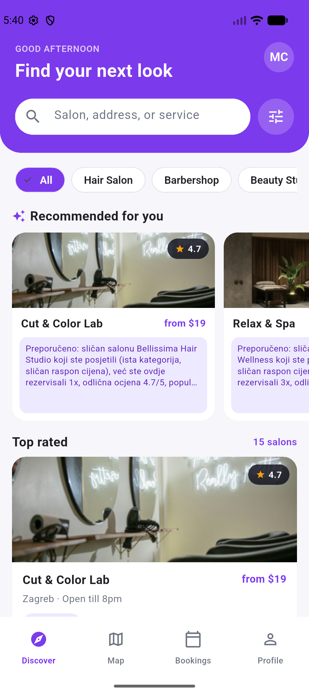

# Sistem preporuke — CutCal

Preporuke salona prikazuju se korisniku (ulozi `Customer`) na početnom ekranu mobilne aplikacije u sekciji **Recommended for you**. Uz svaki salon prikazuje se i **objašnjenje** zašto je preporučen.

- Endpoint: `GET /Recommendations?lat=&lng=` (samo `Customer`, korisnik se uzima iz JWT-a)
- Zahtjev za novi model: `POST /Recommendations/Retrain` (samo `Admin`)
- Model: `backend/CutCal.Recommender/SalonRecommenderModel.cs`; trening: `backend/CutCal.Worker/Training/`; rangiranje: `backend/CutCal.Services/Services/RecommendationService.cs`
- **Pristup:** hibridni, objašnjiv recommender. **Algoritam:** kolaborativno filtriranje faktorizacijom matrice (*Matrix Factorization*, one-class varijanta za implicitne povratne informacije), ML.NET `Microsoft.ML.Recommender` (LIBMF). Model se stvarno trenira nad podacima aplikacije; sadržajni signali (kategorija, grad, cijena, ocjena, udaljenost) služe za finije rangiranje i za objašnjenje.

## 1. Podaci koje model uči

Svi signali se stvarno upisuju u bazu tokom korištenja aplikacije i svi se koriste.

| Signal | Gdje se upisuje | Tabela | Kako se koristi |
|---|---|---|---|
| Rezervacije (nisu otkazane) | kreiranje rezervacije | `Appointments` | pozitivan signal u modelu; objašnjenje |
| Omiljeni saloni | dodavanje/uklanjanje favorita | `Favorites` | pozitivan signal u modelu; objašnjenje |
| Pregled salona | `POST /Salons/{id}/View` pri otvaranju ekrana salona; ponovni pregled istog salona unutar 10 minuta se ne broji | `SalonViews` | pozitivan signal u modelu; objašnjenje |
| Recenzije korisnika | ostavljanje recenzije | `Reviews` | rezervacija koju je kupac ocijenio 1 ili 2 zvjezdice ne ulazi u trening kao pozitivan signal |
| Ocjena salona (`AvgRating`) | preračunava se pri svakoj recenziji | `Salons` | komponenta *quality* |
| Pretraga po kategoriji | `GET /Salons?categoryId=` (klik na kategoriju na početnom ekranu) | `UserSearchHistories` | interes za kategoriju (dio komponente naučene preferencije); objašnjenje |
| Popularnost (broj rezervacija svih korisnika) | agregat nad rezervacijama | `Appointments` | komponenta *popularity* |
| Lokacija korisnika | šalje je mobilna aplikacija (`lat`, `lng`), ne čuva se | — | komponenta *proximity* |

**Matrica interakcija.** Redovi su korisnici, kolone saloni. Polje je 1 ako je korisnik rezervisao, stavio u favorite ili pregledao salon (dovoljan je bilo koji od tri signala). Matrica je binarna, pa u naučenom dijelu nema ručno biranih težina. Koriste se svi korisnici koji imaju barem jednu interakciju.

## 2. Model: faktorizacija matrice

Svaki korisnik i svaki salon dobije vektor od 4 latentna faktora; što je skalarni proizvod veći, to je veća vjerovatnoća da će se salon korisniku svidjeti. Koristi se *one-class* funkcija gubitka (`SquareLossOneClass`): poznata polja (1) se aproksimiraju, a nepoznata se vuku prema maloj vrijednosti. Zato salon koji korisnik još nije koristio dobije visok skor ako se po faktorima poklapa s ukusom korisnika, odnosno s korisnicima sličnih navika.

| Hiperparametar | Vrijednost |
|---|---|
| Broj latentnih faktora (`ApproximationRank`) | 4 |
| Iteracija | 20 |
| Stopa učenja | 0.1 |
| Regularizacija (`Lambda`) | 0.025 |
| `Alpha` / `C` (one-class) | 1 / 0.0001 |
| Niti / seed | 1 / 1 (isti podaci daju isti model) |

Broj faktora je izabran offline evaluacijom (poglavlje 6): isprobano je 2, 3, 4, 5, 6 i 8, a 4 daje najbolji rezultat. Kad je broj faktora blizu broja salona (ukupno ih je 15), model samo pamti matricu umjesto da generalizuje.

## 3. Treniranje i upravljanje modelom

- **Worker** (`CutCal.Worker`, zaseban kontejner) čita rezervacije, favorite i preglede iz baze i trenira model: pri pokretanju i zatim svaki sat. Ako trening ne uspije (npr. baza još nije spremna), greška se zapiše i pokušaj se ponavlja nakon 30 sekundi.
- **Na zahtjev:** `POST /Recommendations/Retrain` (Admin) stavlja poruku u RabbitMQ red `cutcal.recommender.retrain` i odmah odgovara `202`; Worker trenira u pozadini. Ako broker nije dostupan, endpoint vraća `503` s porukom.
- **Model** je jedan fajl, `recommender-model/recommender.zip` (putanja: `Recommender__ModelPath`), koji sadrži ML.NET model i popis korisnika i salona koje poznaje. Worker ga upisuje atomski (privremeni fajl pa premještanje), a API ga čita sa zajedničkog Docker volumena `recommender_model` (samo za čitanje).
- **Učitavanje u API-ju** (`RecommenderModelProvider`): pri svakom zahtjevu provjerava vrijeme izmjene fajla i ponovo ga čita samo kad se promijenio, pa novi model radi bez restarta. Ako se novi fajl ne može pročitati, zadržava se prethodni model. Dok modela nema, koristi se cold start.
- Model ocjenjuje samo korisnike i salone koje je vidio pri treningu. Novi korisnik ili novi salon postaje poznat tek poslije sljedećeg treninga.

## 4. Konačni rezultat (hibrid)

Rezultat je ponderisani prosjek **samo komponenti koje su dostupne** za tog korisnika:

| Komponenta | Vrijednost (0–1) | Težina |
|---|---|---|
| Naučena preferencija | skor modela (ograničen na 0–1), pomiješan sa interesom za kategoriju: `0.75 · model + 0.25 · min(broj_pretraga_kategorije, 3) / 3` | 0.40 |
| Proximity | `1 − min(udaljenost_km, 20) / 20` (haversine); izostavlja se ako lokacija nije poznata | 0.20 |
| Quality | `AvgRating / 5` | 0.25 |
| Popularity | `broj_rezervacija_salona / najveći_broj_rezervacija_među_salonima` | 0.15 |

`score = Σ (težina · vrijednost) / Σ težina` (težine dostupnih komponenti se normalizuju). Vraća se najviše 10 salona, sortiranih po `score` opadajuće.

Težine u ovoj tabeli i omjer 75/25 su **ručno zadani hiperparametri finog rangiranja, nisu naučeni**. Naučen je samo model (poglavlje 2).

**Cold start.** Ako model ne postoji ili ne poznaje korisnika (novi korisnik bez historije), komponenta naučene preferencije izostaje (ili se svodi na interes za kategoriju ako korisnik ima historiju pretraga), pa preporuka počiva na komponentama *quality*, *popularity* i, ako je lokacija poznata, *proximity*. To je u suštini preporuka po popularnosti, i ne krije se: lista je tada ista za sve korisnike (uz istu lokaciju). Čim korisnik ima interakcije i worker istrenira novi model, lista se personalizuje.

## 5. Objašnjenje preporuke

Svaka preporuka nosi tekst `Reason`, sastavljen samo od signala koji su stvarno primjenjivi:

- sličan salonu X koji ste posjetili / iz vaših favorita / koji ste pregledali, uz razloge sličnosti (ista kategorija, isti grad, sličan raspon cijena), kad je sličnost ≥ 0.5. Sličnost salona je sadržajna: `0.6 · ista_kategorija + 0.2 · isti_grad + 0.2 · bliskost_cijena`, gdje je `bliskost_cijena = 1 − min(|cA − cB| / max(cA, cB), 1)` (neutralnih 0.5 ako cijena nije poznata). Izabire se korisnikov salon koji je najsličniji preporučenom.
- pretraživali ste kategoriju Y (Nx), ako nema sličnog salona,
- **često ga biraju korisnici sličnih navika**: skor modela je ≥ 0.3, a korisnik taj salon još nije rezervisao, pregledao ni stavio u favorite (za salone koje već koristi, objašnjenje su njegove vlastite rezervacije),
- već ste ovdje rezervisali Nx / pregledali ste ga Nx, u vašim favoritima,
- udaljenost od korisnika (kad je proximity ≥ 0.5),
- odlična (≥ 4.5) ili dobra (≥ 4.0) ocjena,
- popularan (najmanje 3 rezervacije i ≥ 50% najpopularnijeg salona).

Ako nijedan signal nije primjenjiv, prikazuje se: `Preporučeno na osnovu opće popularnosti salona.`

## 6. Evaluacija (offline)

Nakon svakog treninga Worker upisuje u log rezultat offline evaluacije (`RecommenderEvaluator`). Postupak je *leave-one-out*: za svakog korisnika s dva ili više salona sakrije se jedan salon, model se trenira na ostatku, a pita se da li se skriveni salon nalazi u prvih K među salonima koje korisnik nije koristio. Ponavlja se u 5 rundi (svaki put drugi skriveni salon) i uzima se prosjek. Model se poredi s najjednostavnijom osnovicom, popularity baseline-om (preporuči ono što je najpopularnije). Evaluacija se ne računa kad ima manje od 10 takvih korisnika.

Mjereno na demo podacima (56 korisnika, 435 parova korisnik–salon):

| K | HitRate model | HitRate popularity baseline |
|---|---|---|
| 1 | 20.7% | 9.6% |
| 3 | 55.7% | 32.9% |
| 5 | 81.1% | 60.7% |

Primjer iz loga Workera u pokrenutom sistemu: `Offline evaluation (leave-one-out, 56 customers): HitRate@3 is 60.7 % for the model and 38.9 % for the popularity baseline.` (broj se malo razlikuje od tabele jer živa baza ima i nekoliko dodatnih budućih termina).

Evaluacija ocjenjuje samo naučeni model, a ne konačno rangiranje, koje uz njega miješa ocjenu, udaljenost i popularnost.

## 7. Podaci za testiranje

Baza se pri prvom pokretanju puni demo podacima: 15 salona i 11 kupaca s istorijom, a posebni seeder (`RecommenderDemoDataSeeder`) dodaje još 45 kupaca (`customer11`..`customer55`). Svaki od njih ima ukus (dvije susjedne kategorije salona) i prema njemu 4 rezervacije, 2 favorita i 7 pregleda, pa model ima od čega da uči. Podaci su deterministički i seeder se izvršava samo jednom.

## 8. Ograničenja

- Baza je mala (15 salona), a demo podaci su sintetički i imaju ugrađene ukuse, pa su apsolutni brojevi iz poglavlja 6 optimistični. Na tako malom broju salona prednost faktorizacije nad jednostavnim metodama nije velika.
- Model se osvježava jednom satno ili na zahtjev admina, pa nove interakcije ne utiču odmah.
- Težine finog rangiranja su ručno zadane, ne naučene.
- Ne postoji vremenska dimenzija: starije interakcije vrijede koliko i nove.
- Evaluacija mjeri samo naučeni model.

## 9. Konfiguracija

Putanja modela je u konfiguraciji (`Recommender__ModelPath`, `.env.example`; zadano `recommender-model/recommender.zip`); Docker Compose zajednički volume montira u API (samo čitanje) i Worker. Hiperparametri, težine i pragovi su imenovane konstante na početku klasa `SalonRecommenderModel` i `RecommendationService`; nema magičnih brojeva u samom izračunu.

## 10. Performanse

- Jedan upit po vrsti signala (grupisanje u bazi po salonu), bez upita unutar petlje.
- Odobreni saloni i broj rezervacija po salonu (isti za sve korisnike) keširaju se u `IMemoryCache` na jedan minut, pa novi salon, ocjena ili rezervacija utiču na preporuke najkasnije za minut. Korisnikovi vlastiti signali čitaju se pri svakom zahtjevu.
- Predikcija za jednog korisnika je jedan grupni poziv modela za sve salone.
- Model se učitava jednom i drži u memoriji; ponovo se čita samo kad se fajl promijeni.
- Trening na demo podacima traje oko 200 ms.

## 11. Izvorni kod glavne logike

Trening i predikcija modela, `backend/CutCal.Recommender/SalonRecommenderModel.cs`:

```csharp
    public static SalonRecommenderModel Train(IEnumerable<Interaction> interactions)
    {
        var distinct = interactions.Distinct().ToList();
        if (distinct.Count == 0)
        {
            throw new ArgumentException("At least one interaction is needed to train the model.", nameof(interactions));
        }

        var userIds = distinct.Select(x => x.UserId).Distinct().Order().ToList();
        var salonIds = distinct.Select(x => x.SalonId).Distinct().Order().ToList();
        var userIndex = ToIndex(userIds);
        var salonIndex = ToIndex(salonIds);

        var ml = new MLContext(Seed);
        var entries = distinct.Select(x => new MatrixEntry { Row = userIndex[x.UserId], Column = salonIndex[x.SalonId], Label = PositiveLabel });
        var data = ml.Data.LoadFromEnumerable(entries, SchemaFor(userIds.Count, salonIds.Count));

        var trainer = ml.Recommendation().Trainers.MatrixFactorization(new MatrixFactorizationTrainer.Options
        {
            MatrixRowIndexColumnName = nameof(MatrixEntry.Row),
            MatrixColumnIndexColumnName = nameof(MatrixEntry.Column),
            LabelColumnName = nameof(MatrixEntry.Label),
            LossFunction = MatrixFactorizationTrainer.LossFunctionType.SquareLossOneClass,
            ApproximationRank = ApproximationRank,
            NumberOfIterations = Iterations,
            LearningRate = LearningRate,
            Lambda = Lambda,
            Alpha = Alpha,
            C = NegativeEntryValue,
            NumberOfThreads = 1,
            Quiet = true
        });

        return new SalonRecommenderModel(ml, trainer.Fit(data), data.Schema, userIds, salonIds);
    }

    public IReadOnlyDictionary<int, float> Score(int userId, IEnumerable<int> salonIds)
    {
        var known = salonIds.Distinct().Where(_salonIndex.ContainsKey).ToList();
        if (known.Count == 0 || !_userIndex.TryGetValue(userId, out var row))
        {
            return new Dictionary<int, float>();
        }

        var entries = known.Select(id => new MatrixEntry { Row = row, Column = _salonIndex[id] });
        var scored = _model.Transform(_ml.Data.LoadFromEnumerable(entries, SchemaFor(_userIds.Count, _salonIds.Count)));
        var scores = _ml.Data.CreateEnumerable<MatrixScore>(scored, reuseRowObject: false).Select(x => x.Score);
        return known.Zip(scores).ToDictionary(x => x.First, x => x.Second);
    }
```

Rangiranje, `backend/CutCal.Services/Services/RecommendationService.cs`, metoda `GetRecommendationsAsync`:

```csharp
    public async Task<List<RecommendationResponse>> GetRecommendationsAsync(int customerId, double? lat, double? lng)
    {
        var salons = await _context.Salons.AsNoTracking()
            .Include(x => x.SalonCategory)
            .Include(x => x.City)
            .Include(x => x.WorkingHours)
            .Include(x => x.Services)
            .Where(x => x.IsApproved)
            .ToListAsync();

        var myBookings = await CountBySalonAsync(_context.Appointments.Where(x => x.CustomerId == customerId && x.StateName != AppointmentStateNames.Cancelled).Select(x => x.SalonId));
        var allBookings = await CountBySalonAsync(_context.Appointments.Where(x => x.StateName != AppointmentStateNames.Cancelled).Select(x => x.SalonId));
        var myViews = await CountBySalonAsync(_context.SalonViews.Where(x => x.UserId == customerId).Select(x => x.SalonId));
        var favorites = (await _context.Favorites.Where(x => x.UserId == customerId).Select(x => x.SalonId).ToListAsync()).ToHashSet();
        var categorySearches = await _context.UserSearchHistories.Where(x => x.UserId == customerId)
            .GroupBy(x => x.SalonCategoryId)
            .Select(g => new { CategoryId = g.Key, Count = g.Count() })
            .ToDictionaryAsync(x => x.CategoryId, x => x.Count);

        var candidates = salons.Select(s => new Candidate(
            s,
            s.Services.Where(x => x.IsActive).Select(x => (decimal?)x.Price).Average(),
            lat.HasValue && lng.HasValue ? SalonManagementService.DistanceKm(lat.Value, lng.Value, s.Latitude, s.Longitude) : null)).ToList();

        // Empty while there is no model yet or the model has never seen this customer (cold start).
        var modelScores = _modelProvider.Current?.Score(customerId, candidates.Select(x => x.Salon.Id)) ?? new Dictionary<int, float>();

        var seeds = candidates
            .Where(c => myBookings.ContainsKey(c.Salon.Id) || myViews.ContainsKey(c.Salon.Id) || favorites.Contains(c.Salon.Id))
            .Select(c => new Seed(c, myBookings.GetValueOrDefault(c.Salon.Id), favorites.Contains(c.Salon.Id)))
            .ToList();

        var maxBookings = Math.Max(allBookings.Values.DefaultIfEmpty(0).Max(), 1);
        var maxSearches = categorySearches.Values.DefaultIfEmpty(0).Select(x => Math.Min(x, SearchCountCap)).Max();

        var results = candidates.Select(c =>
        {
            var bestSeed = seeds
                .Where(s => s.Candidate.Salon.Id != c.Salon.Id)
                .MaxBy(s => Similarity(c, s.Candidate));

            float? modelScore = modelScores.TryGetValue(c.Salon.Id, out var scored) ? scored : null;
            double? learned = modelScore.HasValue ? Math.Clamp(modelScore.Value, 0, 1) : null;

            var searchCount = categorySearches.GetValueOrDefault(c.Salon.SalonCategoryId);
            double? searchInterest = maxSearches > 0 ? (double)Math.Min(searchCount, SearchCountCap) / SearchCountCap : null;
            if (searchInterest.HasValue)
            {
                learned = learned.HasValue
                    ? (1 - SearchShareInLearned) * learned.Value + SearchShareInLearned * searchInterest.Value
                    : searchInterest;
            }

            double? proximity = c.DistanceKm.HasValue ? 1 - Math.Min(c.DistanceKm.Value, MaxDistanceKm) / MaxDistanceKm : null;
            var quality = c.Salon.AvgRating / 5.0;
            var bookingCount = allBookings.GetValueOrDefault(c.Salon.Id);
            var popularity = (double)bookingCount / maxBookings;

            var components = new List<(double Weight, double Value)>
            {
                (WeightQuality, quality),
                (WeightPopularity, popularity)
            };
            if (learned.HasValue) components.Add((WeightLearned, learned.Value));
            if (proximity.HasValue) components.Add((WeightProximity, proximity.Value));
            var score = components.Sum(x => x.Weight * x.Value) / components.Sum(x => x.Weight);

            var response = c.Salon.Adapt<SalonResponse>();
            response.DistanceKm = c.DistanceKm.HasValue ? Math.Round(c.DistanceKm.Value, 2) : null;

            return new RecommendationResponse
            {
                Salon = response,
                Score = Math.Round(score, 4),
                Reason = BuildReason(c, bestSeed, modelScore, searchCount, proximity, myBookings.GetValueOrDefault(c.Salon.Id), myViews.GetValueOrDefault(c.Salon.Id), favorites.Contains(c.Salon.Id), bookingCount, popularity)
            };
        });

        return results.OrderByDescending(x => x.Score).Take(MaxResults).ToList();
    }
```

Trening u Workeru (`backend/CutCal.Worker/Training/RecommenderTrainer.cs`), evaluacija (`backend/CutCal.Recommender/RecommenderEvaluator.cs`) i učitavanje modela u API-ju (`backend/CutCal.Services/Recommendation/RecommenderModelProvider.cs`) su u istim projektima.

## 12. Preporuke u pokrenutoj aplikaciji

Ekran Discover (mobilna aplikacija, korisnik `mobile`), sekcija **Recommended for you**, sa stvarno generisanim objašnjenjima:



Prvih pet preporuka za tog korisnika (odgovor `GET /Recommendations`; aplikacija na slici nije poslala lokaciju, pa nema komponente udaljenosti):

1. **Cut & Color Lab**, skor 0.9466: Preporučeno: sličan salonu Bellissima Hair Studio koji ste posjetili (ista kategorija, sličan raspon cijena), već ste ovdje rezervisali 1x, odlična ocjena 4.7/5, popularan (30 rezervacija).
2. **Relax & Spa**, skor 0.941: Preporučeno: sličan salonu Zen Garden Wellness koji ste posjetili (ista kategorija, sličan raspon cijena), već ste ovdje rezervisali 3x, odlična ocjena 4.6/5, popularan (29 rezervacija).
3. **Perfect Nails Studio**, skor 0.8961: Preporučeno: sličan salonu Nail Art Boutique koji ste posjetili (ista kategorija, sličan raspon cijena), već ste ovdje rezervisali 1x, dobra ocjena 4.1/5, popularan (34 rezervacija).
4. **Zen Garden Wellness**, skor 0.868: Preporučeno: sličan salonu Relax & Spa koji ste posjetili (ista kategorija, sličan raspon cijena), već ste ovdje rezervisali 1x, dobra ocjena 4.4/5, popularan (27 rezervacija).
5. **Old Town Barbers**, skor 0.8647: Preporučeno: sličan salonu Sharp Edge Barbershop koji ste posjetili (ista kategorija, sličan raspon cijena), **često ga biraju korisnici sličnih navika**, odlična ocjena 4.6/5, popularan (29 rezervacija).

Prve četiri su saloni koje korisnik već koristi (objašnjenje su njegove rezervacije), a peti je salon koji još nije koristio i preporučuje se na osnovu naučenog modela.
